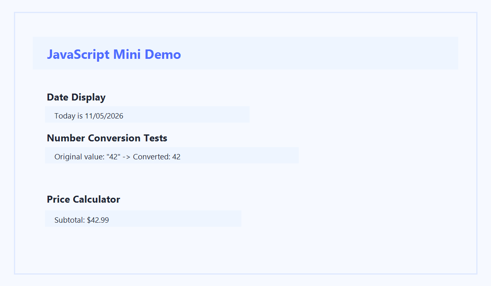

# JavaScript Mini Demo

## Live Site

- GitHub Pages: https://jerrod1201.github.io/cit384-hw9/

## Screenshot

## Built-in Objects and Methods Used

This project used several JavaScript built-in objects and methods to complete the assignment and extend it with a practical price calculator.

- `Date` object
  - `new Date()`
  - `getMonth()`
  - `getDate()`
  - `getFullYear()`
- `String` methods
  - `padStart()`
- `Number` object and methods
  - `Number()`
  - `Number.isNaN()`
  - `Number.isInteger()`
  - `Number.parseFloat()`
- `Number` formatting methods
  - `toFixed()`
- DOM methods
  - `document.getElementById()`
  - `document.createElement()`
  - `element.appendChild()`
  - `element.addEventListener()`
  - `element.textContent`
  - `element.innerHTML`

## Extra Credit

I went beyond the basic assignment by turning the third section into a live interactive price calculator. The calculator includes:

- user inputs for item price, tax rate, and shipping cost
- automatic calculation updates as values change
- conditional logic to show shipping and tax messages
- a cleaner, more polished presentation with light CSS styling

## Reflection

This project helped me practice connecting JavaScript to the browser and using built-in objects in a meaningful way. I learned how to display dynamic content on the page, format dates correctly, validate numeric values, and perform arithmetic calculations with conditional output. The extra credit price calculator also showed me how a simple interface can turn a demo into something more realistic and presentation-ready.

## Sources

These are the MDN Web Docs references used for the JavaScript features in this project:

- Date: https://developer.mozilla.org/en-US/docs/Web/JavaScript/Reference/Global_Objects/Date
- String.prototype.padStart(): https://developer.mozilla.org/en-US/docs/Web/JavaScript/Reference/Global_Objects/String/padStart
- Number: https://developer.mozilla.org/en-US/docs/Web/JavaScript/Reference/Global_Objects/Number
- Number.isNaN(): https://developer.mozilla.org/en-US/docs/Web/JavaScript/Reference/Global_Objects/Number/isNaN
- Number.isInteger(): https://developer.mozilla.org/en-US/docs/Web/JavaScript/Reference/Global_Objects/Number/isInteger
- Number.parseFloat(): https://developer.mozilla.org/en-US/docs/Web/JavaScript/Reference/Global_Objects/Number/parseFloat
- Number.prototype.toFixed(): https://developer.mozilla.org/en-US/docs/Web/JavaScript/Reference/Global_Objects/Number/toFixed
- Document.getElementById(): https://developer.mozilla.org/en-US/docs/Web/API/Document/getElementById
- Document.createElement(): https://developer.mozilla.org/en-US/docs/Web/API/Document/createElement
- EventTarget.addEventListener(): https://developer.mozilla.org/en-US/docs/Web/API/EventTarget/addEventListener
- Node.textContent: https://developer.mozilla.org/en-US/docs/Web/API/Node/textContent
- Element.innerHTML: https://developer.mozilla.org/en-US/docs/Web/API/Element/innerHTML
